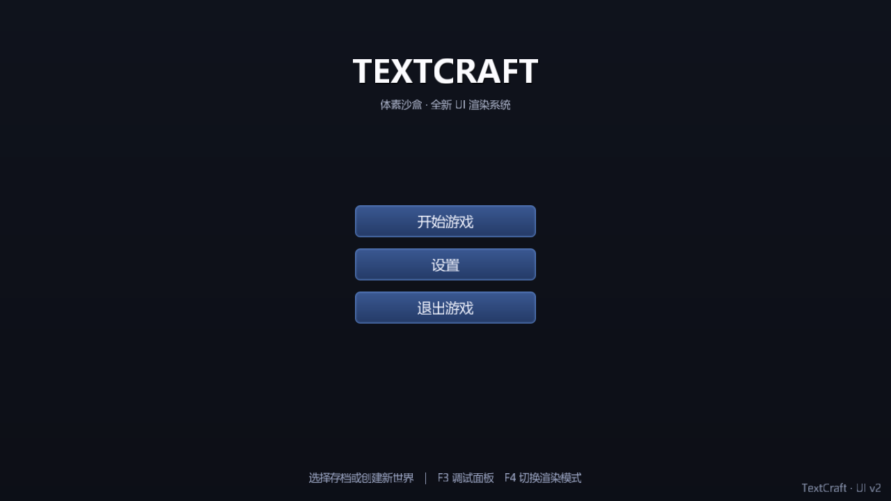
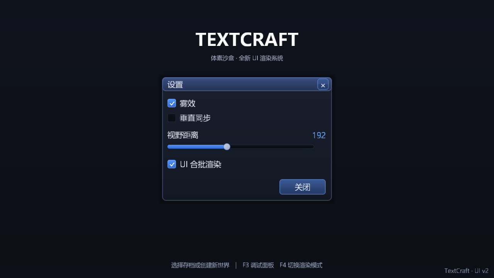
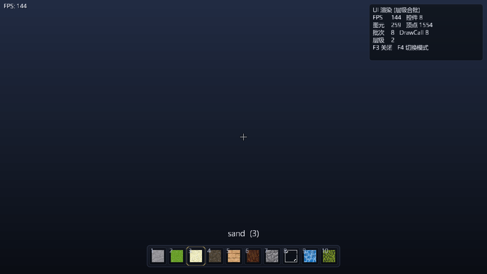
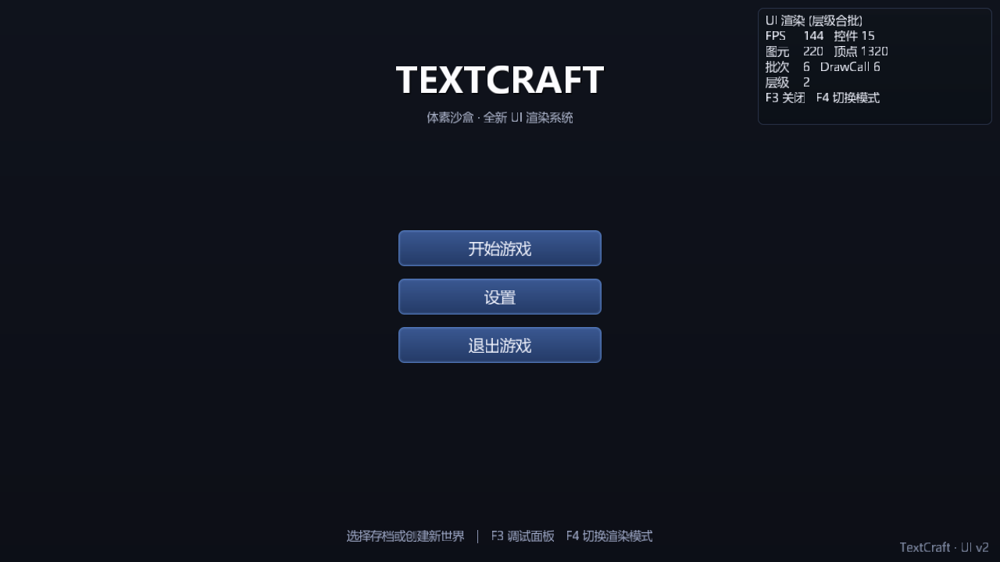

<div align="center">

# TextCraft

一个基于 C# 和 OpenTK 开发的 3D 体素游戏引擎

[](https://opensource.org/licenses/MIT)
[](https://dotnet.microsoft.com/)
[](https://docs.microsoft.com/en-us/dotnet/csharp/)

</div>

## 📖 项目简介

TextCraft 是一个使用 C# 开发的开源 3D 体素游戏引擎，灵感来源于 Minecraft。项目采用模块化设计，使用 OpenGL 进行渲染，是一个轻量、性能良好的体素游戏开发框架。

## ✨ 特性

- 🎮 **体素世界渲染** - 基于区块（Chunk）的世界管理系统
- 🎨 **现代 OpenGL 渲染** - 使用 GLSL 着色器，支持纹理、环境光遮蔽（AO）
- 🖱️ **第一人称控制** - 完整的玩家移动和视角控制系统
- 🎯 **物理系统** - 基础的碰撞检测与物理模拟
- 📦 **资源管理** - 纹理、模型等资源的高效加载与管理
- 🧩 **数据驱动** - 方块模型与方块种类由 `Config/Tables` 下的 JSON 定义，增删方块无需修改代码
- 🧱 **外部模型** - 支持 `.obj`(+MTL) 与 `.fbx` 导入，可按名称取得 `Grid` 或直接挂到实体上渲染
- 🖥️ **UI 渲染系统** - 按 UI 层级合并 Mesh：全屏 UI 只上传一次顶点、每层仅数个 DrawCall；真实字形度量 + 多字体、九宫格精灵、按钮/开关/滑块/输入框/下拉框/可拖动窗口等复合控件
- 💾 **存档界面** - 「开始游戏」进入可视化存档列表（下拉选择，显示种子与最后游玩时间），也可输入名称与种子创建新世界；游戏内 ESC 打开暂停面板（继续游戏 / 保存并退回主菜单 / 设置 / 退出）
- 🔧 **模块化架构** - 清晰的代码结构，易于扩展和维护

## 🛠️ 技术栈

| 类别 | 技术 | 版本 |
|------|------|------|
| 语言 | C# | 10.0 |
| 框架 | .NET | 8.0 |
| 图形库 | OpenTK | 4.9.4 |
| 图像处理 | SixLabors.ImageSharp | 3.1.12 |
| 字符处理 | SixLabors.Font | 3.0.0 |

## 📁 项目结构
```
 TextCraft/
 ├── TextCraft/              # 主项目目录
 │   ├── src/
 │   │   ├── Core/           # 核心模块
 │   │   │   ├── ChunkModel/ # 区块模型
 │   │   │   ├── Config/     # 配置管理
 │   │   │   ├── Input/      # 输入系统
 │   │   │   ├── Physic/     # 物理系统
 │   │   │   ├── Game.cs     # 游戏主类
 │   │   │   ├── World.cs    # 世界管理
 │   │   │   └── ... 
 │   │   ├── Rendering/      # 渲染模块
 │   │   │   ├── BaseShader.cs
 │   │   │   ├── GameShader.cs
 │   │   │   ├── Grid.cs
 │   │   │   ├── GridMgr.cs
 │   │   │   ├── IRenderer.cs
 │   │   │   ├── Atlas.cs            # 多图集 + 九宫格精灵
 │   │   │   └── UI/                 # UI 渲染：顶点/绘制列表/合批/着色器
 │   │   │       ├── UIVertex.cs     # 顶点格式、材质、合批键
 │   │   │       ├── UIDrawList.cs   # 绘制列表：排序、合批、压平
 │   │   │       ├── UIMeshBuffer.cs # 单个动态 VBO
 │   │   │       ├── UIBatchRenderer.cs
 │   │   │       ├── UIShader.cs
 │   │   │       └── UIRenderer.cs
 │   │   ├── UI/             # UI 框架：布局、控件、输入、主题、资源
 │   │   │   ├── UIComponent.cs      # 控件基类（层级/锚点/绘制/事件）
 │   │   │   ├── UIRect.cs / UILayout.cs / UILayers.cs
 │   │   │   ├── UIFont.cs / UITheme.cs / UIAssets.cs
 │   │   │   ├── UIInput.cs          # 命中检测与事件分发
 │   │   │   ├── UIMgr.cs / UITable.cs
 │   │   │   ├── UIDiagnostics.cs    # --validate-ui / --ui-capture
 │   │   │   ├── Widgets/            # Panel/Image/Label/Button/Toggle/Slider/ProgressBar/Window/Hotbar
 │   │   │   │                       # 另有 TextField（输入框）、Dropdown（下拉框）
 │   │   │   └── Panels/             # WorldSelect（存档列表+新建世界）/ PauseMenu（ESC 暂停）
 │   │   ├── Table/          # 数据表（从 JSON / 外部文件加载）
 │   │   │   ├── BlockTable.cs        # 方块元数据与烘焙后的几何
 │   │   │   ├── ModelTable.cs        # 具名方块/实体模型
 │   │   │   ├── ImportedModelTable.cs # 外部模型（OBJ/FBX）注册与 Grid 查找
 │   │   │   ├── UIConfig.cs          # ui.json 加载与校验
 │   │   │   ├── AtlasTable.cs        # 图集兼容转发层
 │   │   │   ├── TableLoader.cs       # 启动时统一加载入口
 │   │   │   └── EntityModelTable.cs
 │   │   ├── Save/           # 存档
 │   │   │   └── SaveList.cs          # 存档目录扫描 + 世界名校验（只读，不改存档格式）
 │   │   ├── Collections/    # 集合工具
 │   │   └── Tools/          # 工具类（ModelImport/ 外部模型导入器、FontBaker 字体烘焙）
 │   └── TextCraft.csproj    # 项目文件
 ├── RequiredResources/      # 运行期资源（构建时自动同步到输出目录）
 ├── TextCraft.sln           # 解决方案文件
 ├── docs/                   # 开发文档（UI 系统、存档界面/暂停面板、JSON 化改造、外部模型导入与回滚手册）
 ├── LICENSE.txt             # 许可证
 └── README.md               # 项目说明
```
### 📦 运行期资源

```
RequiredResources/
├── Config/
│   ├── config.xml
│   └── Tables/
│       ├── blocks.json          # 方块定义（id/type/名称/类型/模型/图集 tile…）
│       ├── imported_models.json # 外部模型注册表（名称→OBJ/FBX/缩放/UV/纹理）
│       ├── models/*.json        # 方块/实体模型定义（一个文件一个模型）
│       └── ui/ui.json           # UI 图集、字体、主题、渲染选项
├── Resources/                   # 纹理、字体、UI 图集、外部模型文件（test_model/，含 fbx/）
│   └── atlas/
│       ├── uiAtlas/             # 原有 UI 图集（方块图标、准星、标题）
│       └── uiSkin/              # 新增：界面皮肤（按钮/面板/窗口…，带九宫格）
└── Save/                        # 示例存档
```

`blocks.json` 与 `models/*.json` 的字段说明、校验规则、改动点与回滚方式见
[docs/block-model-json-loading.md](docs/block-model-json-loading.md)。

### 🖥️ UI 系统（多层级合批 + 复合控件）

- 所有 UI 元素共享一份顶点数组与一个 VBO，按 `Background → World → Hud → Panel → Window → Popup → Overlay → Debug`
  八个层级排序后，再按 (纹理, 采样方式, 裁剪矩形) 合并批次：主菜单 136 → **4** 个 DrawCall
  （设置窗口 246 → 7，游戏 HUD 247 → 8）；
- 字体用真实字形度量烘焙（支持中文、多套字号），精灵支持多图集与九宫格，全部在
  `Config/Tables/ui/ui.json` 中配置；
- 控件：`UIPanel` / `UIImage` / `UILabel` / `UIButton` / `UIToggle` / `UISlider` / `UIProgressBar` /
  `UIWindow` / `UIHotbar` / `UITextField` / `UIDropdown`，已用于主菜单、存档列表、新建世界、
  游戏 HUD、暂停面板、设置窗口、加载遮罩与 F3 调试面板；
- 存档界面与暂停面板的说明、验证与回滚手册见 [docs/save-ui-and-pause-menu.md](docs/save-ui-and-pause-menu.md)；
- 游戏内按 `F3` 打开渲染统计，按 `F4` 在"合批 / 逐控件 DrawCall"之间切换对比；
- 架构、合批算法、配置字段、修改点与回滚手册见 [docs/ui-system.md](docs/ui-system.md)。

### 🧱 外部模型（OBJ / FBX）导入

- 模型文件（OBJ / FBX）放在 `Resources/test_model`（或配置中的其它 `searchPaths`），支持基础材质纹理/纯色 MTL（无贴图时按材质颜色生成调色板），在
  `Config/Tables/imported_models.json` 里登记名称、文件、缩放/偏移/UV 等参数；
- 内置查找入口：

  ```csharp
  // 按名称取得可直接渲染的 Grid
  if (ImportedModelTable.Ins.TryCreateGrid("fbx_cube_binary", out Grid grid))
  {
      grid.Pos = new Vector3(0, 64, 0);
  }

  // 直接把实体的网格设为外部模型
  world.SpawnModelEntity("fbx_cube_binary");
  ```

- 游戏控制台：`/Models` 列出已加载的外部模型，`/SpawnModel fbx_cube_binary`/`/SpawnModel iron_pickaxe` 在视线前方生成实体；
- 格式支持、转换规则、扩展方式与回滚说明见
  [docs/external-model-import.md](docs/external-model-import.md)。

### 安装与运行

1. **克隆仓库**
```
git clone https://github.com/Xingkellh562/TextCraft.git
```

2. **还原依赖**
 ```
dotnet restore
 ```
3. **构建项目**
 ```
dotnet build --configuration Release
 ```
4. **运行游戏**
 ```
dotnet run --project TextCraft/TextCraft.csproj
```
5. **资源同步与数据表自检**

构建时会把仓库根目录的 `RequiredResources` **自动同步**到输出目录（如 `bin\Debug\net8.0`），不再需要手工复制：

- `Config`、`Resources` 每次构建增量复制；
- `Save` 下的示例存档仅在输出目录还没有 `Save` 时复制，避免覆盖游戏存档；
- 可用 `-p:SkipRequiredResourcesSync=true` 关闭同步。

修改方块/模型 JSON 后，可以不开窗口快速校验：

```
dotnet run --project TextCraft/TextCraft.csproj -- --validate-tables
```

看到“已加载模型 … 个、方块 … 种、外部模型 … 个”及各模型/方块清单即表示配置正确；否则会打印具体错误、文件位置与修改建议。

修改 UI 配置（`Config/Tables/ui/ui.json`、字体、图集）后，可以不开窗口自检 UI：

```
dotnet run --project TextCraft/TextCraft.csproj -- --validate-ui
```

会打印图集/字体统计、控件树、各画面的 DrawCall 对比（合批 vs 逐控件），并模拟一遍
"悬停 → 点击按钮 → 打开窗口 → 点开关 → 拖滑块"的交互；全部 PASS 时退出码为 0。

还可以离屏渲染 UI 截图（隐藏窗口 + FBO，不会弹窗），便于做视觉回归：

```
TextCraft\bin\Debug\net8.0\TextCraft.exe --ui-capture docs\images --size 1280x720
```

🎮 **操作说明**
 
| 按键 | 功能 |
|------|------|
| W / A / S / D  | 移动 |
| 鼠标 | 视角控制 |
| 空格 | 上升 |
| Shift | 下降 |
| Esc | 打开/关闭暂停面板（暂停时冻结世界并释放鼠标） |
| F3 | 调试面板（控件/图元/顶点/批次/DrawCall/层级） |
| F4 | 切换 UI 渲染模式（合批 / 逐控件 DrawCall） |

控制台命令：`/LoadWorld <name> [seed]`、`/UnLoadWorld`、`/tp x y z`、`/Models`、`/SpawnModel <name>`
 
## 🗺️ 开发路线图
 
- 基础渲染框架(完成)
- 区块系统雏形(完成)
- 玩家控制系统(完成)
- 世界生成算法(完成)
- 方块放置与破坏(完成)
- 多纹理支持(完成)
- JSON 数据驱动的方块/模型系统(完成)
- 外部模型导入（OBJ/FBX，按名称生成 Grid）(完成)
- UI 系统（多层级合批、字体/图集管线、复合控件）(完成)
- 存档功能(基本完成)
- 地物放置(开发中)
- 光照系统(开发中)
- 音效系统(计划中)
- 多人联机(计划中)

***注:完成不代表我停止开发，我可能会在后续新增(完善)功能或优化***

## 🖼️ 运行效果


UI 系统截图（`--ui-capture` 离屏渲染，详见 [docs/ui-system.md](docs/ui-system.md)）：

| 主菜单（4 DrawCall） | 设置窗口（7 DrawCall） |
| --- | --- |
|  |  |

| 游戏 HUD（8 DrawCall） | 调试面板 |
| --- | --- |
|  |  |

| 存档列表 + 新建世界（9 DrawCall） | ESC 暂停面板（10 DrawCall） |
| --- | --- |
|  |  |

| 展开存档下拉（候选列表在 Popup 层，11 DrawCall） |
| --- |
|  |

## 🤝 贡献指南
 
欢迎提交 Issue 和 Pull Request！
 
1. Fork 本仓库

2. 创建你的特性分支 ( git checkout -b feature/AmazingFeature )

3. 提交你的更改 ( git commit -m 'Add some AmazingFeature' )

4. 推送到分支 ( git push origin feature/AmazingFeature )

5. 开启一个 Pull Request
 
## 📄 许可证
 
本项目采用 MIT 许可证 - 详见 LICENSE.txt 文件。
 
## 🙏 致谢
 
- OpenTK - .NET 平台的 OpenGL 绑定

- SixLabors.ImageSharp - C# 图像处理库

- SixLabors.Font - C# 字符处理库
