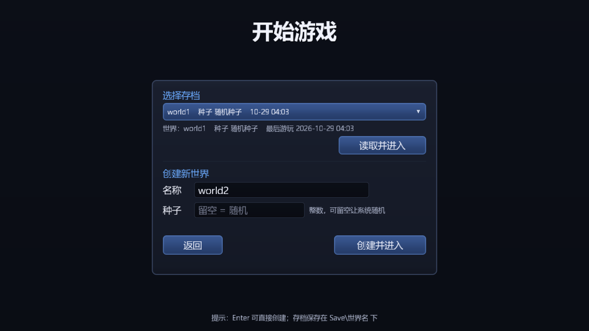

# 可视化存档列表、新建世界输入框与 ESC 暂停面板

> 基线：UI 系统重构（多层级合批 + 复合控件）完成之后的工作区状态
> （前一份文档见 [docs/ui-system.md](ui-system.md)）。
>
> 本文档是这批功能的**设计说明 + 修改点清单 + 回滚手册**。改动同样没有提交 git，
> 可用 `git status` / `git diff` 审阅；回滚步骤见第 9 节。

---

## 1. 目标与结论

| 需求 | 实现 | 状态 |
| --- | --- | --- |
| 「开始游戏」进入存档列表（可视化） | 新增 `UIWorldSelectPanel`：读 `Save/*/worldData.xml` 扫描存档，用下拉框列出「名字 + 种子 + 最后游玩时间」 | ✅ |
| 存档列表用下拉菜单显示 | 新增 `UIDropdown`：候选列表提升到 `UILayers.Popup` 层，点候选以外的地方/按 ESC 自动收起，空间不够时向上翻转 | ✅ |
| 输入名称与种子创建世界 | 新增 `UITextField`（光标、水平滚动、占位提示、数字过滤）；校验重名/非法字符，种子留空则随机 | ✅ |
| 游戏内 ESC 暂停面板 | 新增 `UIPauseMenu`（继续游戏 / 保存并退回主菜单 / 设置 / 退出游戏）；ESC 切换，暂停时冻结世界逻辑并释放鼠标 | ✅ |
| 保存并退回主菜单要真的保存 | `World.UnLoad` 前等待区块后台线程落盘（见 6.4）；实测 `worldData.xml` 时间戳更新 | ✅ |
| 可验证 | `--validate-ui` 交互自检扩到 **18 项**全 PASS；另有**实机鼠标+键盘自动化**走通"开始游戏→读档→ESC→保存并退出"与"输入种子→建世界"两条链路 | ✅ |

---

## 2. 界面与流程

```
主菜单 (mainMenu, Panel)
  └─「开始游戏」─────────────────────────────┐
                                             ▼
                    UIWorldSelectPanel (Panel, 全屏遮罩 + 居中卡片)
                      ├─「选择存档」UIDropdown ──(展开)──> UIPanel popup (Popup 层)
                      ├─ 存档信息：世界 / 种子 / 最后游玩
                      ├─「读取并进入」→ LoadWorldEventArg{name, seed=0}   (种子以存档为准)
                      ├─「创建新世界」UITextField 名称 / UITextField 种子
                      │     └─「创建并进入」→ LoadWorldEventArg{name, seed}
                      └─「返回」→ 主菜单
                                             ▼
                                      进入世界（loadingOverlay → HUD）
                                             ▼
                                      按 ESC ──> UIPauseMenu (Window 层)
                                                  ├─「继续游戏」      → ResumeGameEventArg
                                                  ├─「保存并退回主菜单」→ SaveAndQuitWorldEventArg
                                                  ├─「设置」          → 设置窗口 (Window+500)
                                                  └─「退出游戏」      → RequestExitEventArg
```

截图（`--ui-capture` 离屏渲染）：

| 存档 / 新建世界界面 | 展开存档下拉 |
| --- | --- |
|  |  |

| 游戏内暂停面板 |
| --- |
|  |

---

## 3. 新增控件：`UITextField`

`src/UI/Widgets/UITextField.cs`

- **排版复用 `UILabel`**：内部一个 `UILabel` 子控件负责字形与行缓存，输入框自己只管编辑状态、
  水平滚动、光标与焦点框；`ClipChildren = true` 让长文本被边框裁掉。
- 光标：`_caret` 是字符索引，位置由 `UIFont.GetAdvance` 累加得到；`_scrollX` 保证光标始终在可视区内；
  每 1.06 秒一个闪烁周期（0.62 秒可见）。
- 点击定位：`SetCaretFromPoint` 按字符宽度找最近的光标位置。
- 内容过滤：`UITextContentType.Any / Integer / PositiveInteger`；被过滤掉的字符也返回"已消费"，
  避免继续落到游戏输入里（否则在输入框里打 `w` 会让角色前进）。
- `Placeholder` 是带 setter 的属性：**后设置也会立即刷新**（`new UITextField { Placeholder = ... }`
  这种对象初始化写法也生效）。
- 主题精灵：`textField` / `textFieldFocused`（后者是蓝色描边，用于焦点态）。

```csharp
var field = new UITextField { Font = font, Placeholder = "留空 = 随机", ContentType = UITextContentType.Integer };
UILayout.Place(field, UIAnchorPreset.TopLeft, 92f, 266f, 240f, 34f);
field.Submitted += _ => CreateWorld();          // 回车提交
field.Changed   += f => Validate(f.Text);
```

## 4. 新增控件：`UIDropdown`

`src/UI/Widgets/UIDropdown.cs`

- 候选列表 `_popup` 是**下拉框自己的子控件**，但 `Layer = UILayers.Popup`，因此永远盖在普通面板
  （Panel）与窗口（Window）之上；它跟着下拉框一起布局，不需要把控件在树里搬来搬去。
- 展开方向：默认向下；下方空间不足且上方放得下时自动向上翻转（`OnLayout` 里按根节点高度判断）。
- 收起方式：
  1. 选中某一行（`SelectFromRow`）；
  2. 点击任何"不在本下拉框子树内"的控件——`UIInput.PointerPress` 会调用
     `UIDropdown.NotifyPointerPressed(hover)`；
  3. 按 ESC（`UIMgr.HandleEscape` → `UIDropdown.CloseAllOpen`）；
  4. 切换界面（`EnterMainMenu` / `EnterGame` / `OpenWorldSelect` 都会 `ReleasePointer` → `Reset` 收起）。
- 每行是 `UIDropdownItem`（`Cursor = Hand`，hover 时换 `listItemHover` 底图）。
- `MaxVisibleRows`（默认 10）限制候选行数；超出的存档由面板的提示行说明总数。

## 5. 存档扫描：`SaveList`

`src/Core/Save/SaveList.cs`（**只读，不改存档格式**）

```
Save/
└─ 世界名/
   ├─ worldData.xml   // 相机位置/朝向 + seed（World 原有格式）
   └─ chunkData/      // 每个被修改过的区块一个 .bin
```

| 成员 | 说明 |
| --- | --- |
| `Root` | `<输出目录>/Save` |
| `Enumerate()` | 扫描每个子目录，读 `worldData.xml` 的 `<seed>`，取文件修改时间；按最后游玩时间倒序 |
| `Exists(name)` | 是否已有同名存档 |
| `ValidateName(name)` | 校验是否能安全作为目录名：非空、≤24 字、不含 `\ / : * ? " < > |` 与控制字符、不是 `.`/`..`；返回 `null` 表示合法，否则返回中文提示 |

`SaveSlotInfo.Display` 就是下拉里那一行：`624    种子 12345    10-29 04:02`。
没有 `worldData.xml` 但存在 `chunkData` 的目录也会列出（种子显示"随机种子"）。

> 存档文件损坏时不会抛异常，只是种子读不到按 0 处理 —— 列表永远可用。

## 6. 暂停面板与暂停语义

### 6.1 开关

`Game.OnKeyDown` 里 ESC 走**边沿触发**：

```csharp
if (e.IsRepeat && (e.Key == Keys.Escape || F3 || F4)) return;   // 忽略长按自动重复
if (e.Key == Keys.Escape) { if (_escapeHeld) return; _escapeHeld = true; }
...
HandleEscape();   // UI 优先（输入框失焦 / 收起下拉 / 关闭设置窗口），否则切换暂停
```

`_escapeHeld` 在 `OnKeyUp` 复位，并用 `KeyboardState.IsKeyReleased(Keys.Escape)` 每帧兜底
（万一焦点丢失导致 keyup 丢失，也不会永久卡住）。

### 6.2 暂停做了什么

| 项 | 处理 |
| --- | --- |
| 世界逻辑 | `GameSession.Paused = true` → `Update` 跳过 `World.Update`（区块线程照常，画面冻结） |
| 鼠标 | **`CursorState = Normal`**（否则光标仍被抓取，UI 收不到点击 —— 这是实测中发现的一个 bug） |
| UI 输入 | 暂停面板 `BlocksPointer = true`，点击不会穿透到游戏 |
| 游戏输入 | `GameplayInputActive` 要求"已载入 && 未暂停 && 光标抓取 && 无输入框焦点"，暂停/编辑时全部失效 |
| 继续游戏 | 恢复 `Paused`/`Grabbed`，隐藏面板 |

### 6.3 保存并退回主菜单

```
UIPauseMenu「保存并退回主菜单」
   → SaveAndQuitWorldEventArg
   → Game.OnSaveAndQuit
        → UnLoadWorldEventArg
             → GameStateMgr.SwitchState(MainMenu)
                  → session.UnLoadWorld()
                       → World.UnLoad(): 写 worldData.xml + 提交所有区块删除请求 + 等待落盘
        → UITable.EnterMainMenu()（存档列表下次打开会重新扫描，能看到刚保存的世界）
```

### 6.4 顺带修掉的三个真问题

1. **暂停后面板点不动**：`PauseGame()` 只设置了 `_paused`，忘了把光标从 `Grabbed` 放出来，
   于是 `OnMouseDown` 里"光标自由才转发给 UI"的判断直接跳过了。已在 `PauseGame()` 里补
   `CursorState = CursorState.Normal`。
2. **偶发"点不中"**：悬停用的是 `MouseMoveEventArgs.X/Y`，而按下/抬起用的是
   `NativeWindow.MousePosition`——两者在窗口缩放/最大化后可能差一帧，导致"看到按钮高亮但点不动"。
   现在统一用一个 `PointerPosition`（优先用移动事件记录的坐标，没有移动过才退回 `MousePosition`）。
3. **`ChunkUpdateMgr` 停止后线程空转，且卸载时不等落盘**：
   - 原 `Update()` 把 `_chunkUpdateRuning` 读到局部变量后就再也不看，`StopChunkUpdate()` 之后线程
     仍在 `while(true)` 里空转，**每次卸载世界都漏一个占满 CPU 的线程**；现在每轮重新读标志、
     队列空闲时 `Thread.Sleep(1)`，停止信号到达且待删除队列清空后正常退出。
   - 原 `World.UnLoad()` 提交完区块删除请求就立刻 `Dispose`，后台线程可能还没写盘。
     新增 `StopChunkUpdateAndWait(timeout)`，`UnLoad`/`Dispose` 都会等线程真正退出（最多 8 秒）。
   - 实测："保存并退回主菜单"后 `Save/624/worldData.xml` 的修改时间从 `03:41:56` 变成 `04:02:16`。

---

## 7. 代码修改点（逐文件）

### 7.1 新增

| 文件 | 作用 |
| --- | --- |
| `src/UI/Widgets/UITextField.cs` | 文本输入框（`UITextContentType` 枚举也在这里） |
| `src/UI/Widgets/UIDropdown.cs` | 下拉框 + `UIDropdownItem`（候选行） |
| `src/UI/Panels/UIWorldSelectPanel.cs` | 存档列表 / 新建世界界面 |
| `src/UI/Panels/UIPauseMenu.cs` | ESC 暂停面板 |
| `src/Core/Save/SaveList.cs` | 存档扫描、`SaveSlotInfo`、世界名校验 |
| `docs/save-ui-and-pause-menu.md` | 本文档 |

### 7.2 修改

| 文件 | 改动 |
| --- | --- |
| `src/UI/UIInput.cs` | 新增文本焦点（`FocusedText`/`SetTextFocus`/`HasTextFocus`）、`HandleKeyDown`/`HandleTextInput`、按下时通知下拉框收起、`Reset` 清理焦点与下拉 |
| `src/UI/UIMgr.cs` | 暴露 `HasTextFocus`、`CursorShape`、`HandleKeyDown`、`HandleTextInput`、`HandleEscape` |
| `src/UI/UIComponent.cs` | 新增 `Root`（树根）、`Cursor`（指针形状） |
| `src/UI/UILayers.cs` | 新增 `UICursorShape`、`UISkin.TextField/TextFieldFocused/ArrowDown/ListItem/ListItemHover` |
| `src/UI/UITable.cs` | 搭 `UIWorldSelectPanel`/`UIPauseMenu` 并接线事件；`OpenWorldSelect/CloseWorldSelect/OpenPause/ClosePause/SetWorldInfo/HandleEscape`；主菜单「开始游戏」改为打开存档界面；进入/退出界面时收起所有浮层；设置窗口层级提到 `Window+500`（盖在暂停面板之上） |
| `src/UI/UIDiagnostics.cs` | `--ui-capture` 增加 3 张画面（存档界面 / 展开下拉 / 暂停面板）；`--validate-ui` 增加 10 项交互断言（开始游戏、下拉展开与选中、输入框聚焦/输入/退格/数字过滤、创建世界事件、暂停面板、继续游戏事件） |
| `src/Core/Program.cs` | ESC 暂停（边沿触发 + 忽略自动重复 + `KeyboardState` 兜底）；`GameSession.Paused` 联动；输入门控 `GameplayInputActive`；`OnTextInput` 转发字符；`OnLoadWorld`/`OnFinishLoadWorld` 刷新暂停面板世界信息并在加载前先画一帧遮罩；新增 `OnResumeGame`/`OnSaveAndQuit` 事件处理；统一 `PointerPosition`；按悬停控件切换指针形状 |
| `src/Core/GameSession.cs` | 新增 `Paused`，暂停时跳过 `World.Update` |
| `src/Core/Event/EventArg.cs` | 新增 `ResumeGameEventArg`、`SaveAndQuitWorldEventArg` |
| `src/Core/World.cs` | `UnLoad`/`Dispose` 改为 `StopChunkUpdateAndWait()`，保证区块落盘后再释放 |
| `src/Core/ChunkModule/ChunkUpdateMgr.cs` | 后台线程正常退出（重新读停止标志、空闲让出 CPU、`_threadFinished` 标记）；新增 `StopChunkUpdateAndWait` |
| `RequiredResources/Config/Tables/ui/ui.json` | 主题新增 5 个精灵引用；`default`/`small` 的 `extraChars` 扩到 208 个字，`title` 增加「开始游戏已暂停」 |
| `docs/tools/ui_skin_generator.py` | 新增 `textField`/`textFieldFocused`/`arrowDown`/`listItem`/`listItemHover` 五个精灵与三角绘制函数 |
| `RequiredResources/Resources/atlas/uiSkin/*` | 重新生成（26 个精灵） |
| `README.md` | 特性、快捷键、UI 章节与文档入口 |
| `docs/ui-system.md` | 控件表、界面结构、文件清单、验证记录、已知限制 |

> 存档格式、`World`/`ChunkStorage` 的磁盘布局**没有任何改动**，老存档直接可读。

### 7.3 资源

| 文件 | 变更 |
| --- | --- |
| `Resources/atlas/uiSkin/texture.png` + `spirits.xml` | 精灵数 21 → 26（新增输入框、聚焦输入框、箭头、列表行、列表行高亮） |
| `Config/Tables/ui/ui.json` | 主题新增 5 项；字体字符集扩容（新增界面文案用到的 149 个汉字） |

字体图集随之变大：`default` 512×252（327 字形）、`small` 512×156、`title` 512×232。
烘焙时间从 ~700ms 涨到 ~780ms（三套并行）。

---

## 8. 验证记录

### 8.1 构建

```
dotnet build -c Debug   → 0 个警告 0 个错误
dotnet build -c Release → 0 个警告 0 个错误
```

### 8.2 `--validate-ui` 交互自检（18 项，全部 PASS）

当前控件树：93 个控件、24 个可交互，布局耗时 9 ms。

```
[PASS] 悬停命中按钮
[PASS] 点击打开设置窗口
[PASS] 点击开关翻转状态  True -> False
[PASS] 点击滑块改变数值  value=0.24
[PASS] 空白处不命中控件
[PASS] 点击开始游戏进入存档界面
[PASS] 下拉框读到存档  共 3 个，选中=world1    种子 随机种子    10-29 04:03
[PASS] 点击下拉框展开候选
[PASS] 点击候选行收起并选中  world1    种子 随机种子    10-29 04:03
[PASS] 点击输入框获得焦点
[PASS] 输入框接收字符  text='abc'
[PASS] 输入框退格  text='ab'
[PASS] 种子输入框只接受数字  text='7'
[PASS] 创建世界发出加载请求  name=ab seed=7
[PASS] 暂停面板打开
[PASS] 点击继续游戏发出恢复请求
[PASS] 暂停面板可打开设置窗口  settings.Layer=4500 pause.Layer=4000
[PASS] ESC 优先关闭设置窗口
```

### 8.3 实机自动化（真实鼠标/键盘，隐藏不了窗口，所以用截图确认界面）

| 步骤 | 结果 |
| --- | --- |
| 主菜单点「开始游戏」 | 截图显示存档界面（下拉 + 新建世界 + 返回/创建） |
| 点「读取并进入」 | 日志 `准备创建世界: 624（种子 0）`，窗口最大化（客户区 1920×1009） |
| 按 ESC | 日志 `已暂停`；截图显示暂停面板叠加在已冻结的 3D 画面与变暗的 HUD 上 |
| 点「保存并退回主菜单」 | `正在保存世界并退回主菜单…` → `准备卸载世界` → `正在卸载世界中` → `已保存并退回主菜单`；`Save\624\worldData.xml` 修改时间 `03:41:56 → 04:02:16` |
| 点存档界面的种子输入框并输入 `2024`，再点「创建并进入」 | 日志 `准备创建世界: world1（种子 2024）`，`Save\world1` 目录被创建，窗口最大化 |

### 8.4 离屏截图

| 画面 | DrawCall | 顶点 |
| --- | --- | --- |
| `ui-world-select.png` | 9 | 1386 |
| `ui-world-select-open.png`（候选展开） | 11 | 2154 |
| `ui-pause.png` | 10 | 1572 |

合批依旧生效：这些新界面只增加了 1~3 个 DrawCall（下拉候选在 Popup 层单独成批）。

---

## 9. 回滚方案

### 9.1 只回滚这批功能（保留 UI 重构）

```powershell
# 1) 恢复被修改的已跟踪源码
git checkout -- TextCraft/src/UI/UIInput.cs TextCraft/src/UI/UIMgr.cs TextCraft/src/UI/UIComponent.cs `
               TextCraft/src/UI/UILayers.cs TextCraft/src/UI/UITable.cs TextCraft/src/UI/UIDiagnostics.cs `
               TextCraft/src/Core/Program.cs TextCraft/src/Core/GameSession.cs `
               TextCraft/src/Core/Event/EventArg.cs TextCraft/src/Core/World.cs `
               TextCraft/src/Core/ChunkModule/ChunkUpdateMgr.cs `
               RequiredResources/Config/Tables/ui/ui.json `
               RequiredResources/Resources/atlas/uiSkin/spirits.xml `
               RequiredResources/Resources/atlas/uiSkin/texture.png `
               docs/tools/ui_skin_generator.py README.md docs/ui-system.md

# 2) 删除本批新增文件
Remove-Item TextCraft\src\UI\Widgets\UITextField.cs, TextCraft\src\UI\Widgets\UIDropdown.cs
Remove-Item -Recurse TextCraft\src\UI\Panels
Remove-Item TextCraft\src\Core\Save\SaveList.cs
Remove-Item docs\save-ui-and-pause-menu.md
Remove-Item docs\images\ui-world-select.png, docs\images\ui-world-select-open.png, docs\images\ui-pause.png

# 3) 重新构建
dotnet build TextCraft\TextCraft.csproj -c Debug
```

回滚后：主菜单「开始游戏」会回到"直接加载内置示例世界"的旧行为吗？
不会——因为 `UITable` 也回滚了，旧版「开始游戏」按钮本就是加载 `624`；
`Program.cs` 回到"ESC 切换光标抓取"，`ChunkUpdateMgr` 回到旧的忙等实现。

### 9.2 完全回滚到 UI 重构之前

见 [docs/ui-system.md](ui-system.md) 第 16 节的方案 A / B（本批新增文件也要一并删掉）。

### 9.3 回滚检查清单

- [ ] `TextCraft/src/UI/` 下没有 `Panels/`、没有 `UIDropdown.cs`/`UITextField.cs`；
- [ ] `TextCraft/src/Core/Save/` 下没有 `SaveList.cs`；
- [ ] 构建 0 警告 0 错误；
- [ ] 主菜单点「开始游戏」直接进世界（旧行为），没有存档界面；
- [ ] 游戏内按 ESC 只切换光标抓取，没有暂停面板；
- [ ] `dotnet run --project TextCraft/TextCraft.csproj -- --validate-ui` 只剩 5 项交互断言。

---

## 10. 已知限制

1. **无删除 / 重命名存档**：界面上只能读取与新建（删除请直接删 `Save/世界名` 目录）。
2. **世界名不允许中文输入法组字**：`OnTextInput` 只拿得到 GLFW 文本回调给出的字符；中文名需要 IME
   配合，当前未做组字窗。种子只接受整数。
3. **下拉最多 10 行**：存档多于 10 个时只列最近的 10 个（界面提示总数）。
4. **新建世界不可选"是否覆盖已有存档"**：重名会提示换名。
5. **暂停不暂停后台区块线程**：只冻结 `World.Update`（玩家/物理/区块调度逻辑），已在跑的生成任务会继续完成。
6. **保存 = 卸载时保存**：没有独立的"保存"按钮（`World` 的持久化模型就是"卸载时写盘"），
   想要中途存档可以 `保存并退回主菜单` 后立刻再进入。
7. **存档列表不显示体积**：只显示种子与最后游玩时间，避免扫描大量 `.bin` 拖慢界面。
