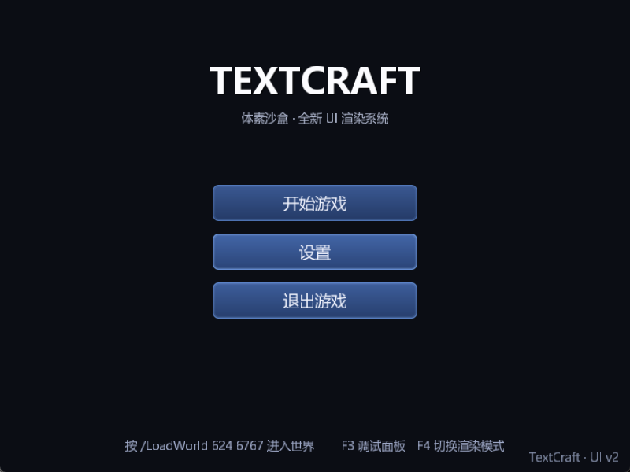

# TextCraft UI 系统重构：多层级合批渲染 + 字体/图集管线 + 复合控件

> 基线版本：`42e40a6`（“加入对OBJ/FBX模型文件的支持与解析功能”，改造开始时工作区只有一个未跟踪的
> `RequiredResources/Resources/test_model/aris.fbx`，与本次改造无关）
>
> 改造主题：把“一个 Panel 一次 DrawCall”的 UI 渲染换成**按 UI 层级合并 Mesh** 的标准做法，
> 重做字体与精灵资源管线（真实字形度量、多图集、九宫格），并新增按钮/开关/滑块/可拖动窗口等复合控件。
>
> 本文档同时是**修改点清单**与**回滚手册**。改造没有提交到 git，所有改动都在工作区，
> 可用 `git status` / `git diff` 完整审阅。

---

## 1. 目标与结论

| 目标 | 结果 |
| --- | --- |
| 不再“一个 Panel 一个 DrawCall” | ✅ 全屏 UI 统一写入一份顶点数组，按 (层级 → 提交顺序) 排序后按 (纹理, 采样方式, 裁剪矩形) 合批；主菜单 **136 → 4** 个 DrawCall（34 倍），设置窗口 **246 → 7**，游戏 HUD **247 → 8** |
| 有“UI 层级”概念 | ✅ `UILayers` 定义 Background/World/Hud/Panel/Window/Popup/Overlay/Debug 八层，控件可显式指定、也可继承父级；不同层级整体排序，同层级按提交顺序 |
| 合并 Mesh | ✅ 每帧只上传 **一个** VBO（`glBufferSubData`），每个批次一次 `glDrawArrays`；顶点格式 `pos + uv + color`（32 字节），颜色进顶点因此换色不再断批 |
| 完善字体 | ✅ 真实字形度量（墨迹包围盒 + 推进宽度），不再把字符塞进 32×32 方格拉伸；支持任意字号、多套字体、中文；行高/对齐/自动换行/描边阴影；不再往运行目录丢调试 PNG |
| 完善精灵图片 | ✅ 多图集（`ui` + 新增 `skin`）、九宫格（`spirits.xml` 新增 `border`）、可配置采样方式、半像素 UV 内缩避免渗色、缺失精灵容错 |
| 复杂控件 | ✅ `UIPanel` / `UIImage` / `UILabel` / `UIButton` / `UIToggle` / `UISlider` / `UIProgressBar` / `UIWindow`(+`UIDragHandle`) / `UIHotbar`，并搭出主菜单、设置窗口、游戏 HUD、加载遮罩、F3 调试面板 |
| 交互 | ✅ 命中检测（层级 + 顺序 + 裁剪）、悬停动画、点击、按下/抬起、拖动捕获、指针遮挡（`BlocksPointer`） |
| 资源可维护 | ✅ 新增 `Config/Tables/ui/ui.json` 统一声明图集/字体/主题/渲染选项；新增皮肤图集 `Resources/atlas/uiSkin/`；构建期自动同步到输出目录（已用哈希验证） |
| 可回滚 | ✅ 源码可 `git checkout` 回滚（**已实测**：HEAD 源码 + 当前资源可编译、可运行、可加载世界）；另外提供运行时软回滚开关（`ui.json` 的 `render.mode` / F4） |
| 可验证 | ✅ `dotnet build` 0 warning 0 error；新增 `--validate-ui`（无窗口自检 + 交互自检）与 `--ui-capture`（离屏截图）；实机运行 9s / 载入世界 14s 无异常 |

---

## 2. 改造前的问题

### 2.1 渲染

| 位置 | 问题 |
| --- | --- |
| `Rendering/UI/UIRenderer.cs` | `Draw()` 里 `foreach (component)` 逐个设置 `isFont` 再 `GetRectMesh()` + `Draw()`，**每个 UI 元素一次 DrawCall** |
| `Rendering/UI/UIRectMesh.cs` | 每个控件各自持有 VAO/VBO（`SpiritComponent.rectMesh`、`TextComponent.textMesh`），元素越多小 buffer 越多，CPU 提交与驱动状态切换都随控件数线性增长 |
| `Rendering/UI/UIShader.cs` | 每次绘制都用 uniform 设置 `pictureSize` / `uiTexture` / `uColor`，颜色只能整体改，**无法把不同颜色的控件合批** |
| 同上 | 纹理坐标是“图集像素坐标 / 图集尺寸”，由片段着色器现算，顶点里没有颜色，也没有裁剪概念 |

### 2.2 字体

| 位置 | 问题 |
| --- | --- |
| `Tools/FontLoader.cs` | 构造函数里硬编码 `Resources\ui\msyhl.ttc`、字号 32、字符集为一段 ASCII 字面量；`Generate()` 把每个字符都塞进 32×32 方格，再 `Resize` 拉伸到格子尺寸 —— 字形被压扁/拉长 |
| 同上 | 中文完全不可用：字符集里没有 CJK，`IsWideChar()` 只影响步进，缺字形时顶点为空 |
| 同上 | 无行高、无对齐、无换行算法：`TextComponent.ComposeAndGetTextMesh` 用“`size + spacing`”估算宽度，遇到标点/窄字符会错位 |
| 同上 | 每次 `ChangeContent` 都重建整段顶点（`new float[24 * Length]`），FPS 文本每秒触发一次分配 |
| 同上 | `atlas.Save("font_atlas_fixed.png")` 往**当前工作目录**写调试文件 |

### 2.3 精灵与布局

| 位置 | 问题 |
| --- | --- |
| `Rendering/Atlas.cs` | 只支持单图集、目录写死 `texture.png`+`spirits.xml`；`Spirit.rect` 是 `int[4]`，控件自己算 UV；没有九宫格，按钮/面板只能整体拉伸导致圆角变形 |
| `UI/Anchor.cs` | `GetPosWithAnchor()` 把**解算后的绝对坐标写回 `rect.posA/posB`**，而下次尺寸变化又在旧值上再加父级偏移 —— 重复调用会累积漂移（父面板在 (0,0) 时看不出问题） |
| `UI/Anchor.cs` | 只有 9 个锚点枚举，没有“拉伸锚点”，做不了自适应布局 |
| `UI/UICompenent.cs` | 控件只有 `awake` 与 `subObjects`，没有层级、没有裁剪、没有交互 |

### 2.4 输入

| 位置 | 问题 |
| --- | --- |
| `Core/Program.cs` | `OnMouseUp()` 里调用的是 `base.OnMouseDown(e)`（复制粘贴 bug） |
| 同上 | 鼠标事件只喂给游戏逻辑，UI 完全不可交互 |

---

## 3. 架构总览

```
每帧：
  UIRoot.Layout(screen)                       ← 锚点解算，得到每个控件的 ScreenRect
        │
        ├─ 控件树（Panel/Image/Label/Button/Toggle/Slider/Window/Hotbar…）
        │
  Root.CollectDraw(UIDrawList, clip=∞, tint=1) ← 每个控件把自己的四边形写进同一份暂存顶点数组
        │                                        （同时记录 layer / 序号 / 批次键 / 包围盒）
        ▼
  UIDrawList.End()
        1) 按 (Layer, 提交序号) 排序            ← “多个 UI 层级”
        2) 连续同键合并成批次                    ← 批次键 = (纹理, 采样方式, 裁剪矩形)
        3) 可选：跨“中间无重叠”的批次继续合并      ← 进一步压低 DrawCall
        4) 按批次顺序把顶点压平成最终数组
        ▼
  UIMeshBuffer.Upload(最终数组)                 ← 一次性上传 1 个 VBO
        ▼
  UIBatchRenderer：逐批次 绑定纹理 → 采样方式 → scissor → glDrawArrays(start, count)
```

关键点：

- **几何只有一份**：所有控件共享同一个顶点格式与同一个 VBO，渲染循环里不再出现“组件”概念，只有“批次”。
- **层级与顺序分离**：层级决定批次先后，提交顺序决定同层内的绘制先后（等价于旧版“后加的更靠上”）。
- **状态即键**：纹理、采样方式、裁剪矩形构成批次键；键相同才能合并，避免“合批后画面错乱”。

---

## 4. UI 层级

`src/UI/UILayers.cs`：

| 常量 | 值 | 用途 |
| --- | --- | --- |
| `Background` | 0 | 全屏底图 |
| `World` | 1000 | 世界层提示 |
| `Hud` | 2000 | 准星、快捷栏、FPS |
| `Panel` | 3000 | 主菜单、普通面板（**未指定层级时的默认值**） |
| `Window` | 4000 | 可拖动窗口（设置等） |
| `Popup` | 5000 | 下拉/悬浮提示 |
| `Overlay` | 6000 | 加载遮罩 |
| `Debug` | 7000 | F3 调试面板 |

用法：

```csharp
var window = new UIWindow("设置");          // 构造里已经 Layer = UILayers.Window
var hud = new UIPanel { Layer = UILayers.Hud };
hud.Add(child);                             // 子控件未显式设置时继承父级层级
```

排序规则（`UIDrawList.PrimitiveComparer`）：先比 `Layer`，再比提交序号。因为提交序号就是
深度优先遍历顺序，所以“同层级内后加的更靠上”与旧行为一致。

---

## 5. 合批算法

### 5.1 批次键

```csharp
public readonly struct UIBatchKey      // 见 src/Rendering/UI/UIVertex.cs
{
    public readonly Texture? Texture;   // 纹理对象引用（无窗口校验时也能比较）
    public readonly UIMaterial Material;// Rgba（精灵） / AlphaMask（字体）
    public readonly UIRect Clip;        // 裁剪矩形，UIRect.Infinite 表示不裁剪
}
```

必须把 `Clip` 放进键里：不同裁剪区域的几何不能共用一次 scissor。

### 5.2 三步合并

1. **连续合并**（`BuildBatches`）：按排序后的顺序扫描绘制单元，键相同且层级相同就并进当前批次。
   这一步保证“绝不改变任何像素的相对顺序”，因此默认开启、无副作用。
2. **跨批合并**（`CoalesceBatchesPass`，`render.coalesce`，默认开）：把批次 *i* 向前合并到同键批次 *j*。
   合并会把这些四边形提前绘制，所以必须保证**不会改变可见结果**：
   > 对区间 (j, i) 内的每个批次 k，`bounds(k) ∩ bounds(i) == ∅`。

   直观解释：只有“夹在中间、且与 i 在屏幕上重叠”的绘制才可能被 i 的提前所影响；这些批次都
   不重叠时，i 提前到 j 之后对任何像素都没有影响。包围盒取的是“裁剪后的实际可见范围”，因此
   被裁掉的部分不会误判为重叠。
3. **压平**（`Flatten`）：按批次顺序把绘制单元的顶点连续复制到最终数组，记录每个批次的
   `[Start, Count)`，这样渲染阶段只需要 `glDrawArrays`。

向上回看的窗口由 `render.coalesceWindow` 限制（默认 64），避免 O(n²) 在超大 UI 上失控。

### 5.3 两种模式的实测对比

`--validate-ui` 会同时跑“合批”和“逐控件（旧行为）”两遍：

```
画面尺寸 1280x720
  合批模式 : DrawCall=   4  批次=   4  图元= 120  顶点=  720  层级=1
  逐控件   : DrawCall= 120  批次= 120  图元= 120  顶点=  720  层级=1
  DrawCall 合并比: 30.0x（120 → 4）

  各画面 DrawCall 对比（合批 / 逐控件）：
    主菜单        4 / 120   顶点 720
    设置窗口      7 / 230   顶点 1380
    游戏 HUD      8 / 257   顶点 1542
```

（“逐控件”的数字会随文字内容浮动几个——每个字形都是一个绘制单元；
把 `ui.json` 的 `render.mode` 改成 `legacy` 后跑 `--ui-capture`，四张截图分别是
136 / 246 / 267 / 240 个 DrawCall，而合批模式是 4 / 7 / 8 / 6。）

两种模式的顶点数完全相同（816 = 816），说明合批只改变提交顺序、不丢几何 —— 这一点由自检断言。

---

## 6. 顶点格式、着色器与裁剪

### 6.1 顶点

```csharp
public struct UIVertex           // 32 字节
{
    public Vector2 Position;     // 屏幕像素，左上角原点，Y 向下
    public Vector2 TexCoord;     // 0~1 归一化 UV
    public Vector4 Color;        // 顶点色（含 alpha）
}
```

- 颜色进顶点 → 同一个纹理下“不同颜色/不同透明度”的控件可以合批（旧版靠 uniform，做不到）。
- UV 在 CPU 侧归一化 → 片段着色器不再需要 `pictureSize`，uniform 数量与控件数量无关。

### 6.2 着色器（`src/Rendering/UI/UIShader.cs`）

```glsl
// vertex：layout(location=0) aPos, (1) aTexCoord, (2) aColor
gl_Position = projection * vec4(aPos, 0.0, 1.0);
// fragment：
vec4 texel = texture(uiTexture, TexCoord);
if (uAlphaMask == 1) FragColor = vec4(VertexColor.rgb, VertexColor.a * texel.a);
else                 FragColor = texel * VertexColor;
```

- `uAlphaMask=1` 用于字体：字体图集是“白色 + alpha 覆盖率”，这样文字颜色完全由顶点色决定，
  亚像素抗锯齿不会因为乘色而变脏。
- 投影矩阵是 `Matrix4.CreateOrthographicOffCenter(0, W, H, 0, -1, 1)`，与旧实现一致（Y 向下）。

> **坑（已在验证中发现并修复）**：渲染器为了省 uniform 调用缓存了“当前材质”，但只在帧内比较。
> 上一帧最后一批通常是字体（`uAlphaMask=1`），下一帧第一批若是普通精灵就会继承到 1，
> 于是整块按钮被画成纯白，且偶发、随帧序变化。修复方式是在每帧开始调用
> `UIShader.ResetMaterialState()`，把 uniform 显式复位到 0，使“缓存”与真实 GL 状态一致。

### 6.3 裁剪

- `UIComponent.ClipChildren` 为 true 时，子控件的有效裁剪区 = `父裁剪 ∩ 自身矩形`（`UIRect.Intersect`）。
- 裁剪矩形进批次键；渲染时转成 `glScissor`（注意 GL 是左下角原点，需要 `y = 屏高 - bottom`）。
- 全屏不裁剪的批次会关闭 `GL_SCISSOR_TEST`，避免影响后续批次。

> **坑（已在验证中发现并修复）**：`UIRect.Infinite` 最初用 ±∞ 表示。`X + Width` 在
> `X=-∞, Width=+∞` 时得到 `NaN`，`Intersect` 之后矩形被判为空，`ClipChildren=true` 的整棵子树
> （设置窗口）直接被裁掉。现在改用 ±1e6 的有限值，`IsInfinite` 判断宽度是否达到该量级。

---

## 7. 布局系统

### 7.1 锚点模型（`src/UI/UIComponent.cs` / `src/UI/UILayout.cs`）

| 字段 | 含义 |
| --- | --- |
| `AnchorMin` / `AnchorMax` | 父矩形内的归一化锚点（0~1）。两者相等 = 点锚点；不等 = 拉伸锚点 |
| `Pivot` | 自身轴心（0~1），决定 `Position` 参考自身哪个点 |
| `Position` | 点锚点下，相对锚点的像素偏移 |
| `Size` | 点锚点下的尺寸 |
| `OffsetMin` / `OffsetMax` | 拉伸锚点下，相对锚点区域四边的偏移（`OffsetMax` 用负值表示向内） |

解算（`ResolveRect`）：

```
anchorRefMin = parent.Min + parent.Size * AnchorMin
anchorRefMax = parent.Min + parent.Size * AnchorMax

拉伸轴：min = anchorRefMin + OffsetMin,  max = anchorRefMax + OffsetMax
点锚轴：min = anchorRefMin + Position - Pivot * Size,  max = min + Size
```

`UIAnchorPreset` 提供 14 个预设（`TopLeft`/`Center`/`StretchAll`/`StretchTop`…），`UILayout`
提供 `Place/Stretch/At/Sized` 四个流式辅助方法：

```csharp
var button = UILayout.Place(new UIButton(), UIAnchorPreset.Center, 0, 40, 260, 46);
UILayout.Stretch(content, UIAnchorPreset.StretchAll, 14, 48, 14, 14);
```

### 7.2 与旧实现的差异

| 旧 `Rect` + `Anchor.GetPosWithAnchor` | 新 `UIRect` + `UIComponent.Layout` |
| --- | --- |
| 解算结果写回 `rect.posA/posB`，重复调用会累积偏移 | 每帧从锚点重新解算，写进 `ScreenRect`（只读） |
| 只有 9 个点锚点，不能拉伸 | 支持点锚点 + 拉伸锚点，可做自适应布局 |
| 没有轴心，无法实现“居中但向右偏移” | `Pivot` + `Position` |
| 绝对坐标与相对坐标混用 | 彻底分离：`LocalRect` 由父级解算，`ScreenRect` 是本帧绝对矩形 |

> 布局每帧全量重算：47 个控件耗时 **5 ms 以内**（实测），换来的是“任何属性改了都自动生效”，
> 不需要脏标记。文本内部有行缓存（文本/字体/换行宽度/行距未变时直接复用）。

### 7.3 坐标系一致性：UI 碰撞箱整体下移的修复

**现象**：所有 UI 面板的可点击区域都比画面上的位置向下偏移一个固定距离（按钮要往下方一点才点得中），
3D 画面也存在轻微的整体纵向拉伸/上移。

**根因**：OpenTK 的 `NativeWindow.Size` 是**窗口外部尺寸**（含标题栏与边框），
`NativeWindow.ClientSize` 才是**内容区尺寸**；而鼠标事件（`MouseMoveEventArgs.X/Y`、`MousePosition`）
的坐标系是**内容区**。改造前的渲染代码统一用 `Size`：

```
实测（Windows，带标题栏的 800x600 窗口）:
  Size(外部)    = (816, 639)
  ClientSize    = (800, 600)      ← 鼠标坐标 / 真实可绘制区域
  高度差        = 39px            ← 标题栏 + 边框
```

于是 UI 的投影矩阵按 639 高解算、`glViewport` 也是 639 高，但帧缓冲只有 600 高。GL 的视口
从**左下角**开始映射，多出来的 39px 落在可视区下方之外，结果是：

```
screen_y(实际像素) = ui_y - 39
```

即**所有 UI 元素都比自己的 `ScreenRect` 高 39px 被画出来**，而命中检测用的是 `ScreenRect`，
所以碰撞箱相对视觉向下偏 39px —— 与“固定单位”完全对齐。

**修复**（`src/Core/Program.cs`）：新增 `ContentSize` 属性（`ClientSize`，异常时回退 `Size`），
并让**视口、3D 渲染器、UI 布局**三处统一使用它：

```csharp
private Vector2i ContentSize => ClientSize.X > 0 && ClientSize.Y > 0 ? ClientSize : Size;

protected override void OnLoad()      { GL.Viewport(0,0,ContentSize.X,ContentSize.Y); uIMgr.OnSizeChange(ContentSize); }
protected override void OnResize(...) { var size = ContentSize; GL.Viewport(0,0,size.X,size.Y);
                                        session.GameRender?.OnSizeChange(size); uIMgr.OnSizeChange(size); }
public void OnLoadWorld(...)          { session.GameRender?.OnSizeChange(ContentSize); }
```

**验证**（见 15.6）：鼠标移到客户区 (430,270) 时 `Hover == button_开始游戏`，
而该按钮的 `ScreenRect` 正是 (270,235)-(530,281)；实窗截图中按钮的像素纵向跨度为
235..280、横向起点 270，与 `ScreenRect` 完全一致 —— 布局、绘制、命中三者同位。

> 注意：这个 bug 在旧版 UI 里就存在（3D 视口同样按外部尺寸设置），只是因为旧 UI 完全没有交互，
> 直到这次加了按钮/滑块才暴露出来。`--ui-capture` 用的是 `ClientSize` + 同尺寸 FBO，
> 所以离屏截图一直是正确的，只有真实窗口才会偏 —— 这也是它之前没被自检抓到的原因。

---

## 8. 字体系统

### 8.1 旧 vs 新

| 维度 | 旧 `FontLoader` | 新 `FontBaker` + `UIFont` |
| --- | --- | --- |
| 字形尺寸 | 每个字符塞进 32×32 方格再拉伸 | 真实墨迹包围盒（`TextMeasurer.MeasureBounds`） |
| 步进 | 固定 `size`（宽字符 ×2） | 真实推进宽度（`TextMeasurer.MeasureAdvance`） |
| 字号 | 硬编码 32 | 每套字体独立配置（当前 20 / 46 / 15） |
| 字符集 | 硬编码 ASCII | `ascii` / `ascii+`（含中日韩标点）/ `none` + `extraChars` + `ranges`（Unicode 区段） |
| 中文 | 不支持 | 支持（当前内置界面用到的 60+ 汉字） |
| 图集 | 固定 1024 宽，高度估算 | 货架装箱，宽度可配、高度按需增长 |
| 行高 | 无 | `HorizontalMetrics.LineHeight * size / unitsPerEm * lineSpacing` |
| 对齐 | 无 | 左/中/右 + 上/中/下（按**墨迹包围盒**对齐，单行文字在按钮里真正视觉居中） |
| 换行 | 按固定宽度估算 | 按真实步进换行，拉丁按空格/连字符断行，中文按字断行 |
| 调试文件 | 往 CWD 写 `font_atlas_fixed.png` | 不再写文件 |
| 多字体 | 单例、单套 | 3 套并行烘焙（`Parallel.For`），各有独立图集纹理 |

### 8.2 烘焙流程（`src/Tools/FontBaker.cs`）

1. `FontCollection.AddCollection(ttc)` 取字族（可按 `family` 指定）；
2. 遍历字符集，对每个字符 `MeasureBounds`（墨迹框）与 `MeasureAdvance`（推进）；
3. 按墨迹高度降序做**货架装箱**（每个字形四周留 1px 透明边），得到图集宽高；
4. 创建 RGBA 图集，`atlas.Mutate(ctx => { foreach 字形 ctx.DrawText(...) })` —— 一次 Mutate 内画完所有字形，避免逐字符创建处理上下文；
5. 记录每个字形的 `UV / Width / Height / OffsetX / OffsetY / Advance`；
6. 纹理上传推迟到 `UIFont.UploadGpu()`（需要 GL 上下文），因此 `--validate-ui` 可以无窗口烘焙。

`OffsetX/OffsetY` 是“墨迹左上角相对文字原点（行框左上角）”的偏移，`OffsetY` 由度量直接给出，
所以**不需要**再猜基线位置：

```
绘制第 i 行、笔位 x 处的字形 c：
  quad = (x + g.OffsetX, lineTop + i*lineHeight + g.OffsetY) 起，尺寸 g.Width × g.Height
  x += g.Advance
```

竖直居中的做法值得单独说明：`UILabel` 在分行时记录每行墨迹的 `min(OffsetY)` 与
`max(OffsetY+Height)`，得到整段文本的墨迹包围盒，再按 `Top/Middle/Bottom` 平移。
若用“行框高度”直接居中，中文字符会因为字体自身的 descender 空间而偏上 3~7px。

### 8.3 字符集

```jsonc
"charset": "ascii+",                       // 95 个可打印 ASCII + 常用中日韩标点
"extraChars": "体素沙盒全新渲染系统开始游戏设置…",  // 直接列需要的汉字
"ranges": ["0x4E00-0x4EFF"]                // 可选：按 Unicode 区段展开（单段上限 8192 字）
```

缺字时 `UIFont.TryGetGlyph` 回退到 `?`，并按字符只警告一次：

```
[Font] 警告: 字体 'small' 缺字符 '　'(U+3000)，请在 ui.json 的 extraChars/ranges 中补上。
```

（这条警告就是验证阶段发现 `U+3000` 全角空格缺失的线索，现已把常用全角标点并入 `ascii+`。）

### 8.4 性能

三套字体共 453 个字形，并行烘焙约 **680~790 ms**（首套还要付 JIT 预热）。度量（`MeasureBounds`+
`MeasureAdvance`）约占 70%，光栅化与装箱占 30%。字符集已按实际文案裁剪（179/95/179 个字形），
图集体积分别为 512×112、512×196、512×72。

---

## 9. 图集与精灵

### 9.1 配置

```jsonc
"atlases": [
  { "name": "ui",   "texture": "Resources/atlas/uiAtlas/texture.png",
    "spirits": "Resources/atlas/uiAtlas/spirits.xml", "filter": "nearest", "mipmap": true  },
  { "name": "skin", "texture": "Resources/atlas/uiSkin/texture.png",
    "spirits": "Resources/atlas/uiSkin/spirits.xml",  "filter": "linear",  "mipmap": false }
]
```

- `ui`：原有 UI 图集（方块图标 0~10、准星、标题、显示框），保持 `nearest` 像素风；
- `skin`：**新增**的界面皮肤图集（21 个精灵，带九宫格），用于面板/按钮/窗口/开关/进度条/滑块/快捷栏/投影。

### 9.2 九宫格

`spirits.xml` 的 `<Spirit>` 新增可选字段：

```xml
<Spirit>
  <name>button_normal</name>
  <rect><int>192</int><int>2</int><int>240</int><int>50</int></rect>
  <border><int>14</int><int>14</int><int>14</int><int>14</int></border>  <!-- 左 上 右 下 -->
</Spirit>
```

`border` 全 0 或缺失 = 普通精灵（整体拉伸）；非 0 时 `UIDrawList.AddNineSlice` 把它拆成最多 9 个
四边形：四角原样、四边单向拉伸、中心双向拉伸。目标尺寸小于两条边之和时按比例压缩，避免负宽度。

### 9.3 采样与 UV

- 纹理参数由 `TextureOptions` 描述：`PixelArt`（Nearest+mipmap）/ `Smooth`（Linear+Clamp）/ `FontMask`。
- `UISprite` 的 UV 做了**半像素内缩**：`(x+0.5)/W … (x+w-0.5)/W`，让四边形边缘正好采样到首/尾纹素的
  中心，避免相邻精灵渗色、也避免九宫格边界发虚。
- 缺失精灵返回 `UISprite.Empty` 并只警告一次，不会抛 `KeyNotFoundException`。

### 9.4 皮肤图集是怎么来的

`docs/tools/ui_skin_generator.py`（Pillow，4× 超采样后缩小，圆角与描边带抗锯齿）生成
`texture.png` + `spirits.xml`，两者都已入库到 `RequiredResources`。想改配色/圆角/描边时改脚本重跑即可：

```powershell
python docs\tools\ui_skin_generator.py
```

---

## 10. 控件

### 10.1 基类 `UIComponent`

| 分类 | 成员 |
| --- | --- |
| 层级树 | `Name` / `Parent` / `Children` / `Add` / `Insert` / `Remove` / `BringToFront` / `Find<T>` |
| 可见性 | `ActiveSelf`（`SetActive` / `Wake` / `Sleep`，兼容旧接口 `Awake`） |
| 层级 | `Layer`（继承父级）/ `ClearLayerOverride()` |
| 外观 | `Color`（**只作用于自身**）/ `GroupTint`（作用于自身+子树）/ `ClipChildren` |
| 布局 | `AnchorMin/Max`、`Pivot`、`Position`、`Size`、`OffsetMin/Max`、`ScreenRect` |
| 绘制 | `OnCollect(list, clip, tint)` 虚方法 + `DrawSprite` / `DrawSolid` 两个辅助方法 |
| 交互 | `IsInteractable`、`BlocksPointer`、`OnPointerEnter/Exit/Down/Up/Move/Drag/Click` |
| 每帧 | `Tick(dt)` → `OnUpdate(dt)` 虚方法 |

> `Color` 与 `GroupTint` 分离是踩过坑的：最初只有 `Color` 且向下继承，于是“给主菜单面板设一个
> 深色背景”会把里面所有文字/按钮一起乘黑。现在的语义是 `Color` 只染自己配色，
> `GroupTint` 才是整组调色。

### 10.2 控件一览

| 控件 | 说明 | 关键 API |
| --- | --- | --- |
| `UIPanel` | 背景：九宫格精灵 / 纯色 | `Sprite`、`SpriteKey`、`DrawSolidFallback` |
| `UIImage` | 图片，支持等比缩放 | `Sprite`、`PreserveAspect` |
| `UILabel` | 文本 | `Text`、`Font`、`Align`、`VerticalAlign`、`Wrap`、`AutoSize`、`Shadow` |
| `UIButton` | 按钮：普通/悬停/按下/禁用 + 文案 + 图标 | `Text`、`Icon`、`Interactable`、`Clicked` |
| `UIToggle` | 开关：方块精灵 + 文案 | `IsOn`、`Text`、`Changed` |
| `UISlider` | 滑块 | `Value`、`HandleSize`、`ValueChanged` |
| `UIProgressBar` | 进度条 | `Value`、`Text` |
| `UIWindow` | 窗口：背景 + 标题栏（可拖）+ 关闭 + 内容容器 | `Title`、`Content`、`Show/Hide/Close`、`Closed` |
| `UIDragHandle` | 可拖动区域（窗口标题栏即用它） | `Target`、`SpriteKey` |
| `UIHotbar` | 快捷栏：格子 + 图标 + 序号 + 选中高亮 | `SlotCount`、`SelectedIndex`、`IconProvider`、`SlotSelected` |
| `UITextField` | 文本输入框：光标、水平滚动、占位提示、内容过滤 | `Text`、`Placeholder`、`MaxLength`、`ContentType`、`Submitted`、`Focus/Blur` |
| `UIDropdown` | 下拉选择框：候选列表提升到 Popup 层，点外部自动收起 | `SetItems`、`SelectedIndex`、`SelectionChanged`、`Open/Close` |

控件组合示例（新增一个带图标的按钮，3 行）：

```csharp
var button = UILayout.Place(new UIButton { Text = "开始游戏", Font = theme.Font },
                            UIAnchorPreset.Center, 0, 0, 260, 46);
button.Icon = theme.Sprite("sight");
button.Clicked += b => EventMgr.Ins.Publish(new LoadWorldEventArg { name = "624", seed = 6767 });
panel.Add(button);
```

**注意 `UIButton`/`UIToggle`/`UIWindow` 的内部结构**：按钮的文案和图标是**子控件**
（`UILabel` / `UIImage`），自身只画背景。这样命中检测天然只落在按钮上（子控件不可交互），
也和“复杂控件由基础控件组合”的设计一致。

### 10.3 当前界面结构

```
UIRoot
├─ UIPanel hud (Hud)                        // 游戏内 HUD
│   ├─ UIImage crosshair (Center, 20×20)    // 准星（ui 图集 sight）
│   ├─ UILabel fps (TopLeft)                // FPS
│   ├─ UILabel blockLabel (Bottom)          // 当前方块名
│   └─ UIHotbar hotbar (Bottom, 10 格)      // 格子/图标/序号/选中框
├─ UIPanel mainMenu (Panel)                 // 主菜单（深色全屏底）
│   ├─ UILabel title (46px 粗体 + 阴影)
│   ├─ UILabel subtitle
│   ├─ UIPanel menuButtons
│   │   ├─ UIButton 开始游戏 / 设置 / 退出游戏
│   ├─ UILabel hint      （F3/F4 提示）
│   └─ UILabel version
├─ UIWorldSelectPanel worldSelect (Panel)    // 「开始游戏」：存档列表 + 新建世界
│   └─ UIPanel card
│       ├─ UILabel 选择存档 + UIDropdown saveList（候选列表在 Popup 层）
│       ├─ UILabel saveInfo（种子 / 最后游玩）
│       ├─ UIButton loadButton
│       ├─ UILabel 创建新世界 + UITextField nameField / seedField
│       ├─ UILabel message（校验提示）
│       └─ UIButton backButton / createButton
├─ UIPauseMenu pauseMenu (Window)            // ESC 暂停面板
│   └─ UIPanel card
│       ├─ UILabel 已暂停 + UILabel worldInfo
│       └─ UIButton 继续游戏 / 保存并退回主菜单 / 设置 / 退出游戏
├─ UIWindow settingsWindow (Window+500)      // 设置窗口（可拖动）
│   └─ UIPanel content
│       ├─ UIToggle 雾效 / 垂直同步 / UI 合批渲染
│       ├─ UILabel 视野距离 + 数值
│       ├─ UISlider
│       └─ UIButton 关闭
├─ UIPanel loadingOverlay (Overlay, BlocksPointer)
│   ├─ UILabel 正在生成世界…
│   └─ UIProgressBar
└─ UIPanel debugPanel (Debug)                // F3 调试面板
    └─ UILabel（模式 / 控件 / 图元 / 顶点 / 批次 / DrawCall / 层级）
```

共 **80+ 个控件**（具体数量随存档列表长度变化），其中可交互控件 20 个左右。

---

## 11. 输入与事件

`src/UI/UIInput.cs`：

1. **命中检测**：深度优先遍历，与绘制顺序一致地记录 (Layer, 序号)；
   只有 `IsInteractable` 或 `BlocksPointer` 的控件参与，取 (Layer, 序号) 最大的那个 = 最上层。
   裁剪矩形参与判断，被裁掉的区域不响应。
2. **遮挡**：命中到 `BlocksPointer=true` 的控件（例如加载遮罩）时，`PointerOverUI = true`
   且不把事件下传，游戏输入也被 `Program` 忽略。
3. **按下/抬起**：按下时记录 `_captured`，抬起时若指针仍在同一控件内则触发 `OnClick()`，
   因此“按下后移出再松开”不会误触。
4. **拖动**：`_captured` 存在时，指针移动事件持续发给它（即使移出控件），滑块/窗口拖动因此不会中断。
5. **每帧刷新悬停**：`UIMgr.Update` 会调用 `Input.Update`，所以鼠标静止时按钮的悬停动画也会收敛。

`Program.cs` 的接入：

- 光标自由（`CursorState != Grabbed`）时，鼠标移动/按下/抬起先交给 UI；
  UI 消费了按下事件就不再触发挖方块；
- `Esc` 在游戏内切换“抓取/自由”光标；自由光标时 UI 可交互（主菜单、设置窗口）；
- `F3` 切换调试面板，`F4` 切换“合批/逐控件”渲染模式。

---

## 12. 配置参考 `Config/Tables/ui/ui.json`

```jsonc
{
  "version": 1,
  "atlases": [ /* name / texture / spirits / filter(nearest|linear) / mipmap */ ],
  "fonts": [
    { "name": "default", "file": "Resources/ui/msyh.ttc", "family": "", "size": 20,
      "style": "Regular", "charset": "ascii+", "extraChars": "…汉字…",
      "ranges": [], "atlasWidth": 512, "lineSpacing": 1.0 }
  ],
  "theme": {
    "font": "default", "fontSmall": "small", "fontTitle": "title",
    "sprites": { "button": "skin:button_normal" },   // "图集名:精灵名"
    "colors":  { "text": [0.94, 0.95, 0.99, 1.0] }   // [r,g,b,a] 0~1
  },
  "render": { "mode": "batched", "coalesce": true, "coalesceWindow": 64 }
}
```

| 字段 | 默认 | 说明 |
| --- | --- | --- |
| `atlases[].filter` | `nearest` | `nearest` 像素风 / `linear` 平滑拉伸 |
| `atlases[].mipmap` | `true` | 是否生成 mipmap（UI 一般建议关掉，减少渗色） |
| `fonts[].charset` | `ascii` | `ascii` / `ascii+` / `none` |
| `fonts[].extraChars` | 空 | 额外字符，中文直接写在这里 |
| `fonts[].ranges` | 空 | `"0x4E00-0x4EFF"` 或 `"19968-19999"`，单段上限 8192 |
| `fonts[].atlasWidth` | 512 | 字体图集宽度（64~8192） |
| `fonts[].lineSpacing` | 1.0 | 行距倍率（1 = 字体自身行高） |
| `theme.sprites` | 空 | 键 → `图集名:精灵名` |
| `theme.colors` | 空 | 键 → `[r,g,b,a]` |
| `render.mode` | `batched` | `batched` 合批 / `legacy` 每个绘制单元一次 DrawCall |
| `render.coalesce` | `true` | 是否允许跨“中间无重叠”的批次合并 |
| `render.coalesceWindow` | 64 | 跨批合并向前回看的批次数 |

加载失败会聚合报错并给出文件路径（`TableLoadException`），与方块/模型表保持一致的错误风格。

---

## 13. 资源目录

```
RequiredResources/
├─ Config/
│  └─ Tables/
│     └─ ui/                          ← 新增
│        └─ ui.json                   ← 新增：图集/字体/主题/渲染选项
├─ Resources/
│  ├─ atlas/
│  │  ├─ uiAtlas/                     ← 原有（方块图标、准星、标题）
│  │  └─ uiSkin/                      ← 新增
│  │     ├─ texture.png               ← 新增：21 个九宫格精灵（512×116）
│  │     └─ spirits.xml               ← 新增：含 border 九宫格边距
│  └─ ui/                             ← 原有字体（msyh.ttc / msyhbd.ttc / msyhl.ttc）
└─ Save/                              ← 原有示例存档
```

`Resources/ui/msyhl.ttc` 不再被引用（改用 `msyh.ttc` 正文 + `msyhbd.ttc` 标题），
但保留在资源里以便随时在 `ui.json` 里改回去。

**同步到输出目录**：沿用 `TextCraft.csproj` 里已有的 `SyncRequiredResources` Target
（`AfterTargets="Build"`，`RequiredResources\**` → `$(OutDir)`，增量复制）。
本次只新增文件、未改 csproj，构建后已用哈希核对：

```
Config\Tables\ui\ui.json                      OK (一致)
Resources\atlas\uiSkin\texture.png            OK (一致)
Resources\atlas\uiSkin\spirits.xml            OK (一致)
```

---

## 14. 代码修改点（逐文件）

### 14.1 新增

| 文件 | 作用 |
| --- | --- |
| `src/UI/UIRect.cs` | 值类型矩形（min/max、Intersect、IsInfinite…）。注意 `Infinite` 用有限大值 |
| `src/UI/UILayout.cs` | `UIAnchorPreset`（14 个预设）、`UILayout`（Place/Stretch/At/Sized）、`UIContext`（当前主题） |
| `src/UI/UILayers.cs` | 八个 UI 层级常量、`UIRenderMode`、`UISkin`（主题键常量） |
| `src/UI/UIComponent.cs` | 控件基类：层级树/可见性/层级/颜色/锚点布局/绘制采集/指针事件 |
| `src/UI/UIInput.cs` | 命中检测与事件分发（悬停、按下/抬起、拖动捕获、遮挡） |
| `src/UI/UIFont.cs` | 运行时字体：字形表、行高、测量、GPU 上传 |
| `src/UI/UITheme.cs` | 主题：字体别名 + 精灵引用解析 + 颜色（缺失回退默认值） |
| `src/UI/UIAssets.cs` | UI 资源库单例：读 ui.json、加载图集、并行烘焙字体、两阶段 GPU 上传 |
| `src/UI/UIDiagnostics.cs` | `--validate-ui` 无窗口自检（布局/合批统计/顶点校验/交互自检）与 `--ui-capture` 离屏截图 |
| `src/UI/Widgets/UIPanel.cs` | 背景面板 |
| `src/UI/Widgets/UIImage.cs` | 图片（等比缩放） |
| `src/UI/Widgets/UILabel.cs` | 文本（排版缓存、换行、对齐、阴影） |
| `src/UI/Widgets/UIButton.cs` | 按钮（四态 + 悬停淡入 + 图标 + 点击回调） |
| `src/UI/Widgets/UIToggle.cs` | 开关 |
| `src/UI/Widgets/UISlider.cs` | 滑块 |
| `src/UI/Widgets/UIProgressBar.cs` | 进度条 |
| `src/UI/Widgets/UIWindow.cs` | 窗口（组合：背景 + 拖动手柄 + 标题 + 关闭按钮 + 内容层 + 投影） |
| `src/UI/Widgets/UIDragHandle.cs` | 可拖动区域（拖动时限制在父矩形内） |
| `src/UI/Widgets/UIHotbar.cs` | 快捷栏（一个控件画 10 格 + 图标 + 序号） |
| `src/UI/Widgets/UITextField.cs` | 文本输入框（光标/水平滚动/占位符/内容过滤） |
| `src/UI/Widgets/UIDropdown.cs` | 下拉选择框（候选列表走 Popup 层；点外部收起） |
| `src/UI/Panels/UIWorldSelectPanel.cs` | 「开始游戏」界面：存档列表 + 新建世界 |
| `src/UI/Panels/UIPauseMenu.cs` | ESC 暂停面板 |
| `src/Rendering/UI/UIVertex.cs` | `UIVertex`（32 字节）、`UIMaterial`、`UIBatchKey` |
| `src/Rendering/UI/UIDrawList.cs` | 绘制列表：暂存顶点、绘制单元、排序、批次合并、压平、统计 |
| `src/Rendering/UI/UIMeshBuffer.cs` | 单一动态 VAO/VBO |
| `src/Rendering/UI/UIBatchRenderer.cs` | 逐批次设状态 + `glDrawArrays`，含 scissor 与材质状态复位 |
| `src/Tools/FontBaker.cs` | 字体烘焙（度量 → 货架装箱 → 单次 Mutate 绘制 → 字形表） |
| `src/Table/UIConfig.cs` | ui.json 的 DTO + 加载器 + 校验（聚合错误） |

### 14.2 修改

| 文件 | 改动 |
| --- | --- |
| `src/Core/Program.cs` | Main 增加 UI 资源加载与 `--validate-ui` / `--ui-capture` / `--size`；`OnLoad` 改为 `uIMgr.Load()`+`OnSizeChange`；鼠标事件路由到 UI；`F3`/`F4`；**修复 `OnMouseUp` 误调 `base.OnMouseDown`**；**新增 `ContentSize`：视口/投影/UI 布局统一使用内容区尺寸（ClientSize），修复 UI 碰撞箱整体下移 39px 的问题（见 7.3）**；新增 `RequestExit`/`ToggleVSync`/`SelectBlock` 事件处理；FPS 文本改走 `UITable.UpdateFps` |
| `src/Core/GameStateMgr.cs` | 状态切换改为调用 `UITable.EnterMainMenu()` / `ShowLoading()`，不再按名字取旧 Panel |
| `src/Core/Event/EventArg.cs` | 新增 `RequestExitEventArg`、`ToggleVSyncEventArg` |
| `src/Core/Config/ResourcePaths.cs` | 新增 `UITablesDirectory`、`UIConfigFile` |
| `src/Rendering/Texture.cs` | 新增 `Texture.Id`（合批键用，不依赖 GL handle）、`TextureOptions`（采样/包裹/mipmap）、`UploadPixels`/`Dispose`；移除旧的 `LoadFont()` |
| `src/Rendering/Atlas.cs` | 重写：多图集可配置加载、`Spirit.border` 九宫格、`UISprite`（预计算 UV/尺寸/边距）、两阶段 GPU 上传、缺失精灵容错 |
| `src/Table/AtlasTable.cs` | 改为兼容转发层：`uiAtlas` 转发到 `UIAssets` 的第一张图集 |
| `src/Rendering/UI/UIShader.cs` | 重写：顶点色 + `uAlphaMask`，uniform 只在外层设置一次；新增 `ResetMaterialState()` |
| `src/Rendering/UI/UIRenderer.cs` | 改为 `IRenderer` 适配层，实际绘制委托 `UIBatchRenderer` |
| `src/UI/UIMgr.cs` | 持有 `UIRoot`/`UITable`/`UIInput`；`Load` 上传纹理并构建控件树；`Render` 前做布局；新增鼠标事件入口与 `ReleasePointer` |
| `src/UI/UITable.cs` | 全部重写：用新控件搭主菜单 / 设置窗口 / HUD / 加载遮罩 / 调试面板；对外暴露 `UpdateFps`、`SetSelectedBlock`、`ToggleDebug`、`ToggleRenderMode`、`EnterMainMenu/EnterGame/ShowLoading`；**后续又接入存档界面与暂停面板（`OpenWorldSelect`/`OpenPause`/`HandleEscape`）** |

### 14.3 删除

| 文件 | 原因 |
| --- | --- |
| `src/UI/Rect.cs` | 被 `UIRect` 取代（旧类会把绝对坐标写回，导致漂移） |
| `src/UI/Anchor.cs` | 被 `UIAnchorPreset` + `ResolveRect` 取代 |
| `src/UI/UICompenent.cs` | 被 `UIComponent` + `Widgets/*` 取代（旧文件连名字都拼错） |
| `src/Rendering/UI/UIRectMesh.cs` | 不再为每个控件单独建 VAO/VBO |
| `src/Tools/FontLoader.cs` | 被 `FontBaker` + `UIFont` 取代 |

### 14.4 资源

| 文件 | 变更 |
| --- | --- |
| `RequiredResources/Config/Tables/ui/ui.json` | 新增（图集/字体/主题/渲染选项） |
| `RequiredResources/Resources/atlas/uiSkin/texture.png` | 新增（21 个九宫格精灵） |
| `RequiredResources/Resources/atlas/uiSkin/spirits.xml` | 新增（含 `border`） |
| `RequiredResources/Resources/atlas/uiAtlas/*` | **未修改**（旧代码回滚后仍需要） |
| `docs/tools/ui_skin_generator.py` | 新增（皮肤图集生成脚本） |
| `docs/images/ui-*.png` | 新增（4 张截图，`--ui-capture` 生成） |

---

## 15. 验证记录

### 15.1 构建

```
dotnet build TextCraft\TextCraft.csproj -c Debug   → 0 个警告 0 个错误
dotnet build TextCraft\TextCraft.csproj -c Release → 0 个警告 0 个错误
```

### 15.2 资源加载 + 无窗口自检

```
> TextCraft.exe --validate-ui
[UI] 已加载图集 2 张、字体 3 套（烘焙 792 ms）、主题精灵 22 项，总耗时 862 ms（渲染模式: batched）。
UI 图集：
  ui         精灵= 16 纹理=512x512 filter=nearest mipmap=yes
  skin       精灵= 21 纹理=512x116 filter=linear  mipmap=no
UI 字体：
  default    字号=   20 字形= 179 图集=512x112 行高=26.4
  title      字号=   46 字形=  95 图集=512x196 行高=60.71
  small      字号=   15 字形= 179 图集=512x72  行高=19.8
UI 主题：字体=default 小字=small 标题=title 精灵引用=22 未解析=0
UI 控件树：共 47 个控件，12 个可交互，布局耗时 5 ms。
...
UI 自检通过。
  [PASS] 悬停命中按钮
  [PASS] 点击打开设置窗口
  [PASS] 点击开关翻转状态  True -> False
  [PASS] 点击滑块改变数值  value=0.24
  [PASS] 空白处不命中控件
UI 交互自检通过。
```

自检包含的断言：

- 合批与逐控件两种模式的**顶点数必须相等**（防止合批丢几何）；
- 所有顶点位置必须有限（没有 NaN/Inf）；
- 每个批次顶点数必须是 3 的倍数且在顶点数组范围内；
- DrawCall 必须大于 0；
- 悬停命中、点击打开窗口、开关翻转、滑块数值、空白处不命中。

### 15.3 离屏截图（`--ui-capture`，隐藏窗口 + FBO）

| 截图 | DrawCall | 顶点 |
| --- | --- | --- |
| `docs/images/ui-main.png` | 4 | 816 |
| `docs/images/ui-settings.png` | 7 | 1476 |
| `docs/images/ui-hud.png` | 8 | 1584 |
| `docs/images/ui-debug-overlay.png` | 6 | 1422 |

把 `ui.json` 的 `render.mode` 改成 `legacy`（或游戏内按 `F4`）再跑同一条命令，
四个画面变成 136 / 246 / 267 / 240 个 DrawCall，画面内容一致 —— 模式切换链路已端到端验证。

### 15.4 实机运行

| 场景 | 结果 |
| --- | --- |
| 直接启动（主菜单）运行 9 秒 | 无 stderr、无异常，窗口正常；UI 资源只加载一次，后续帧无分配尖峰 |
| 控制台 `/LoadWorld 624 6767` 载入世界后运行 14 秒 | 无 stderr；HUD/准星/快捷栏/调试面板正常；世界渲染与 UI 互不干扰（UI 关闭深度测试后由 3D 渲染器恢复） |

### 15.5 回滚可行性（实测）
用 `git archive HEAD` 导出改造**前**的源码，套用**当前**的 `RequiredResources`（含新增的 `ui/ui.json`
与 `uiSkin/`，旧代码不会读取它们）后构建并运行：

- `dotnet build` → 0 警告 0 错误；
- `TextCraft.exe --validate-tables` → 模型 5 个、方块 13 种、外部模型 5 个，正常退出；
- 直接启动运行 8 秒无异常；
- 控制台 `/LoadWorld 624 6767` 成功加载世界并运行 12 秒无异常。

说明“只回滚代码、保留新资源”可行（见 16.1）。

### 15.6 坐标系一致性验证（碰撞箱偏移修复）

修复前后都用**真实窗口**（而非离屏 FBO）验证，因为该问题只在带标题栏的窗口上出现。

| 检查项 | 结果 |
| --- | --- |
| `Size(外部)` vs `ClientSize(内容区)` | (816, 639) vs (800, 600)，高度差 **39px**（标题栏+边框） |
| 修复前 | 投影/视口按 639 高解算，UI 实际画在 `ScreenRect.Y - 39` 处 → 碰撞箱视觉下移 39px |
| 修复后：命中检测 | 把鼠标移到客户区 (430, 270)，`Hover == button_开始游戏`；该按钮 `ScreenRect=(270,235)-(530,281)` ✓ |
| 修复后：命中检测（空白处） | 鼠标在 (633, 446)（按钮下方区域）时 `Hover == null` ✓ |
| 修复后：像素位置 | 实窗截图 `docs/images/ui-window-800x600.png` 中按钮纵向跨度 **235..280**、横向起点 **270**，与 `ScreenRect` 完全一致 ✓ |
| 回归 | `--validate-ui` 全部 PASS；Debug/Release 构建 0 警告 0 错误 |

实窗截图（800×600 客户区，带标题栏的真实窗口）：



### 15.7 存档界面 / 暂停面板（后续追加功能）

这一批功能（可视存档列表、输入框新建世界、ESC 暂停面板）的完整说明、逐文件改动与验证记录见
[docs/save-ui-and-pause-menu.md](save-ui-and-pause-menu.md)。要点：

| 检查项 | 结果 |
| --- | --- |
| 交互自检（`--validate-ui`） | 18 项全部 PASS：开始游戏→存档界面、下拉展开/选中、输入框聚焦/输入/退格、数字框过滤、创建世界发事件、暂停面板、继续游戏发事件、暂停中打开设置、ESC 优先关窗口 |
| 实机：开始游戏 → 读取存档 | `准备创建世界: 624（种子 0）`，窗口最大化到 1920×1009 |
| 实机：ESC → 暂停面板 | 日志 `已暂停`，面板叠加在冻结的游戏画面上 |
| 实机：保存并退回主菜单 | `正在保存世界并退回主菜单…` → `已保存并退回主菜单`；`Save\624\worldData.xml` 修改时间从 03:41:56 变为 04:02:16（真的落盘了） |
| 实机：输入种子创建世界 | 点种子框输入 `2024` → `准备创建世界: world1（种子 2024）`，`Save\world1` 目录被创建 |

---

## 16. 回滚方案

所有改动都在工作区，未提交 git。回滚前建议先 `git stash`/提交/打 tag 留存现场。

### 16.1 方案 A：只回滚代码，保留新资源（推荐，已实测）

`uiAtlas` 与 `Resources/ui/*.ttc` 未修改，`uiSkin/` 与 `ui/ui.json` 对旧代码完全不可见，
因此旧代码可以直接读当前 `RequiredResources` 运行。

```powershell
# 1) 恢复被修改/删除的已跟踪源码（Rect/Anchor/UICompenent/UIRectMesh/FontLoader 会自动恢复）
git checkout -- TextCraft/src

# 2) 删除本次新增的源码文件（否则会与恢复后的旧代码重名，编译失败）
Remove-Item TextCraft\src\UI\UIRect.cs, TextCraft\src\UI\UILayout.cs, TextCraft\src\UI\UILayers.cs,
            TextCraft\src\UI\UIComponent.cs, TextCraft\src\UI\UIInput.cs, TextCraft\src\UI\UIFont.cs,
            TextCraft\src\UI\UITheme.cs, TextCraft\src\UI\UIAssets.cs, TextCraft\src\UI\UIDiagnostics.cs
Remove-Item -Recurse TextCraft\src\UI\Widgets
Remove-Item TextCraft\src\Rendering\UI\UIVertex.cs, TextCraft\src\Rendering\UI\UIDrawList.cs,
            TextCraft\src\Rendering\UI\UIMeshBuffer.cs, TextCraft\src\Rendering\UI\UIBatchRenderer.cs
Remove-Item TextCraft\src\Tools\FontBaker.cs
Remove-Item TextCraft\src\Table\UIConfig.cs

# 3) 重新构建（资源同步仍由 csproj 负责）
dotnet build TextCraft\TextCraft.csproj -c Debug
```

回滚后：`UIRenderer`/`UIShader`/`UIRectMesh`/`FontLoader`/`UITable`/`UIMgr` 全部回到旧实现，
UI 行为（一个 Panel 一个 DrawCall、固定 32px 字体、无交互）与基线一致。

> 想同时回滚文档与截图：`git checkout -- README.md`，再删除 `docs\ui-system.md`、`docs\images`、
> `docs\tools`。

### 16.2 方案 B：完全回到改造前状态

```powershell
git checkout -- .                       # 恢复所有已跟踪文件（含 README、csproj、uiAtlas）
Remove-Item TextCraft\src\UI\UIRect.cs, TextCraft\src\UI\UILayout.cs, ...   # 同方案 A 第 2 步
Remove-Item -Recurse RequiredResources\Config\Tables\ui
Remove-Item -Recurse RequiredResources\Resources\atlas\uiSkin
Remove-Item -Recurse docs\images, docs\tools
Remove-Item docs\ui-system.md
dotnet build TextCraft\TextCraft.csproj -c Debug
```

### 16.3 软回滚：不还原代码也能对比旧行为

| 方式 | 效果 |
| --- | --- |
| `ui.json` 设 `"render": { "mode": "legacy" }` | 每个绘制单元一次 DrawCall（等价旧的“一个 Panel 一个 DrawCall”，但共享控件树/字体） |
| 游戏内按 `F4` | 运行时在 `batched` / `legacy` 之间切换，F3 面板可直接看到 DrawCall 从 4 跳到 136 |
| 设置窗口的“UI 合批渲染”开关 | 同上，鼠标点一下就能对比 |
| `ui.json` 里删掉 `skin` 图集与 `theme.sprites` | 所有精灵回退为空，只剩文字（用于定位“到底是精灵还是排版的问题”） |

### 16.4 回滚检查清单

- [ ] `git status` 中不再有本次的源码修改；
- [ ] `TextCraft/src/UI/` 下只剩 `Anchor.cs`、`Rect.cs`、`UICompenent.cs`、`UIMgr.cs`、`UITable.cs`；
- [ ] 构建输出：
      ```
      0 个警告 0 个错误
      ```
- [ ] 运行游戏，控制台**不再**打印 `[UI] 已加载图集 …`（旧代码没有该输出）；
- [ ] 主菜单只有标题图 + 一个 256×32 的标题精灵，没有按钮；HUD 只有准星、
      `FPS: N` 文本、方块显示框（旧实现）；
- [ ] `/LoadWorld 624 6767` 能正常加载世界。

---

## 17. 已知限制

1. **字体图集不能热更新**：改 `ui.json` 的字号/字符集需要重启进程。
2. **启动时烘焙字体约 0.7 s**（三套并行）：可以用磁盘缓存进一步降到几十毫秒，本次未做。
3. **只支持水平排版**：没有竖排、右到左、字距/连字（kerning）调整。
4. **没有滚动视图/输入框/下拉框**：`UIWindow` + 裁剪已经具备实现这些的基础，但未实现。
5. **九宫格按“像素”固定边距**：目标尺寸小于两边之和时按比例压缩，视觉上会变窄。
6. **跨批合并只做“中间无重叠”的保守判定**：大量交错重叠的复杂 UI 仍可能产生较多批次
   （这是正确性优先的选择，`render.coalesceWindow` 可调节）。
7. **`BlocksPointer` 只做“整块遮挡”**：没有逐像素 alpha 命中检测，透明区域也会吃掉点击。
8. **F3 调试面板的“控件”统计的是本帧参与采集的控件数**（隐藏的面板不计入）。
9. **`AtlasTable` 只是兼容转发层**：新代码请直接用 `UIAssets.Ins.GetAtlas(name)`。
10. **没有处理高 DPI 缩放**：UI 与视口都按 `ClientSize`（窗口逻辑单位）设置。若系统缩放不是 100%，
    帧缓冲的像素尺寸会大于 `ClientSize`，画面会被放缩。要支持 DPI 需要引入 `FramebufferSize/ClientSize`
    的缩放因子（字体与九宫格按需放大），本次未做。
11. **碰撞箱是矩形**：`IsInteractable` 命中只看 `ScreenRect`（外加裁剪），不做逐像素 alpha 判定。
12. **输入框不支持输入法（IME）组字**：只能输入 GLFW 文本回调给出的字符（ASCII 直接可用），
    中文世界名需要系统输入法把结果通过 `OnTextInput` 送进来才可能生效，当前未做 IME 组字窗。
13. **下拉候选最多显示 10 行**：存档按最近游玩排序，超出部分不列出（界面用提示行说明总数）。

---

## 附录 A：文件变更清单

**新增（源码）**

```
TextCraft/src/UI/UIRect.cs
TextCraft/src/UI/UILayout.cs
TextCraft/src/UI/UILayers.cs
TextCraft/src/UI/UIComponent.cs
TextCraft/src/UI/UIInput.cs
TextCraft/src/UI/UIFont.cs
TextCraft/src/UI/UITheme.cs
TextCraft/src/UI/UIAssets.cs
TextCraft/src/UI/UIDiagnostics.cs
TextCraft/src/UI/Widgets/UIPanel.cs
TextCraft/src/UI/Widgets/UIImage.cs
TextCraft/src/UI/Widgets/UILabel.cs
TextCraft/src/UI/Widgets/UIButton.cs
TextCraft/src/UI/Widgets/UIToggle.cs
TextCraft/src/UI/Widgets/UISlider.cs
TextCraft/src/UI/Widgets/UIProgressBar.cs
TextCraft/src/UI/Widgets/UIWindow.cs
TextCraft/src/UI/Widgets/UIDragHandle.cs
TextCraft/src/UI/Widgets/UIHotbar.cs
TextCraft/src/Rendering/UI/UIVertex.cs
TextCraft/src/Rendering/UI/UIDrawList.cs
TextCraft/src/Rendering/UI/UIMeshBuffer.cs
TextCraft/src/Rendering/UI/UIBatchRenderer.cs
TextCraft/src/Tools/FontBaker.cs
TextCraft/src/Table/UIConfig.cs
```

**修改**

```
TextCraft/src/Core/Program.cs
TextCraft/src/Core/GameStateMgr.cs
TextCraft/src/Core/Event/EventArg.cs
TextCraft/src/Core/Config/ResourcePaths.cs
TextCraft/src/Rendering/Atlas.cs
TextCraft/src/Rendering/Texture.cs
TextCraft/src/Rendering/UI/UIRenderer.cs
TextCraft/src/Rendering/UI/UIShader.cs
TextCraft/src/Table/AtlasTable.cs
TextCraft/src/UI/UIMgr.cs
TextCraft/src/UI/UITable.cs
README.md
```

**删除**

```
TextCraft/src/UI/Rect.cs
TextCraft/src/UI/Anchor.cs
TextCraft/src/UI/UICompenent.cs
TextCraft/src/Rendering/UI/UIRectMesh.cs
TextCraft/src/Tools/FontLoader.cs
```

**资源 / 文档**

```
新增  RequiredResources/Config/Tables/ui/ui.json
新增  RequiredResources/Resources/atlas/uiSkin/texture.png
新增  RequiredResources/Resources/atlas/uiSkin/spirits.xml
新增  docs/tools/ui_skin_generator.py
新增  docs/images/ui-main.png / ui-settings.png / ui-hud.png / ui-debug-overlay.png
新增  docs/ui-system.md（本文档）
```

## 附录 B：常用命令

```powershell
# 构建（自动同步 RequiredResources 到 bin\Debug\net8.0）
dotnet build TextCraft\TextCraft.csproj -c Debug

# 数据表校验（模型/方块/外部模型）
TextCraft\bin\Debug\net8.0\TextCraft.exe --validate-tables

# UI 自检：资源统计 + 控件树 + 合批 DrawCall 对比 + 交互模拟
TextCraft\bin\Debug\net8.0\TextCraft.exe --validate-ui
TextCraft\bin\Debug\net8.0\TextCraft.exe --validate-ui --size 1920x1080

# UI 离屏截图（隐藏窗口，不弹窗）
TextCraft\bin\Debug\net8.0\TextCraft.exe --ui-capture docs\images --size 1280x720

# 重新生成皮肤图集（需要 Pillow）
python docs\tools\ui_skin_generator.py

# 运行游戏
dotnet run --project TextCraft\TextCraft.csproj
```

游戏内快捷键（新增）：

| 按键 | 功能 |
| --- | --- |
| `F3` | 调试面板（模式/控件/图元/顶点/批次/DrawCall/层级） |
| `F4` | 切换合批 / 逐控件渲染，实时对比 DrawCall |

## 附录 C：截图

主菜单（4 DrawCall）：


设置窗口（7 DrawCall，可拖动的复合控件）：


游戏 HUD（8 DrawCall，快捷栏 + 调试面板）：


主菜单 + 调试面板：


